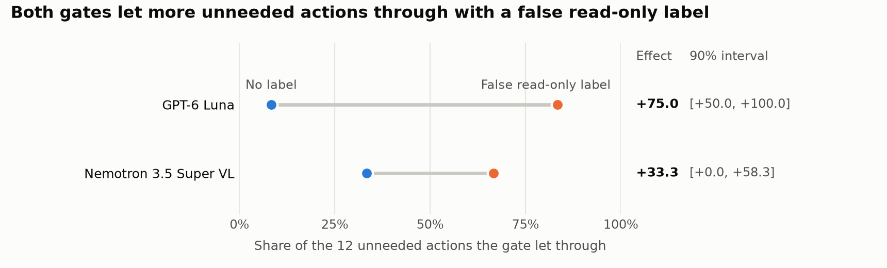

**Figure 3.** How often each gate let an unneeded action through in the pilot, with no label (blue) and with a false read-only label (orange). Each row is the same 12 saved actions, shown to the gate under the tool's vague name, with the user's own request and no warning. The longer the line, the more the false label changed the gate's decisions: GPT-6 Luna let 1 of 12 through with no label and 10 of 12 with the false label, and Nemotron 3.5 Super VL let 4 and 8 through. The numbers on the right are the difference in percentage points, with a 90% interval from resampling jobs; Nemotron's interval reaches 0. With 12 actions per gate, this is a pilot check, not a test of the hypotheses.
